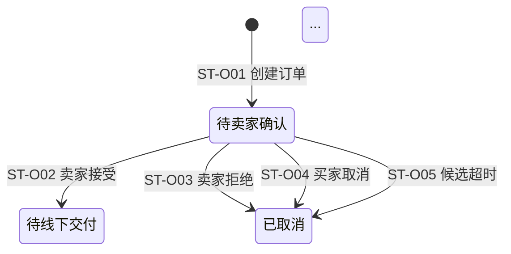
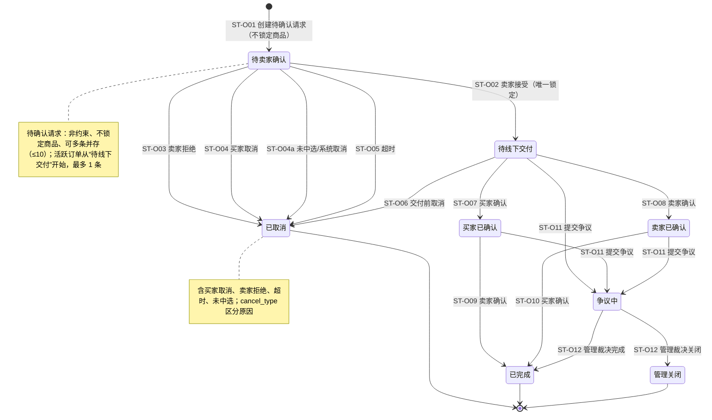

# C-01 修订补丁：待确认请求与活跃订单拆分

- 对应冲突：C-01（活跃订单 vs 待确认订单）
- 裁决：采纳 D-01
- 适用版本：SRS-CSTP-001 v1.1（本次 C-01 修订；基线版本号待团队统一升级）
- 状态：已按本补丁修改 SRS、A/B 报告、M-05/M-06/M-07、E-02/E-03/E-05/E-06/E-08、原型及原型 README、E-09 状态说明；`02_图模型导出/*.svg` 为导出物，需用 Mermaid/PlantUML 重新生成。
- 说明：以下保留“原文 → 改为”对照，便于复核；实际文件已按“改为”内容更新。

---

## 〇、统一口径（先写入 SRS 3.1，其他材料引用）

| 术语 | 定义 |
|---|---|
| 待确认请求（购买申请） | 订单处于“待卖家确认”状态时的业务称谓。非约束、不锁定商品、可多条并存；同一买家对同一商品最多 1 条，同一商品最多 10 条（候选）。 |
| 活跃订单 | 已被卖家接受且未终结的订单，即“待线下交付、买家已确认、卖家已确认、争议中”。同一商品同一时刻最多 1 条。 |
| 未中选 | 卖家接受同一商品的其他请求后，本请求由系统置为“已取消”，取消类型为“未中选”。 |
| 商品锁定 | 仅在卖家接受某条待确认请求时发生；待确认请求本身不构成锁定。 |

**一句话规则**：待确认请求可以有很多条，活跃订单只能有一条；卖家接受一条时，商品锁定，其余请求“未中选”自动取消。

---

## 一、SRS 修改

### 1.1 §1.2 BG-02（第 14 行）

**原文**

> 商品状态对用户可见；同一商品同一时刻最多存在 1 个活跃订单

**改为**

> 商品状态对用户可见；同一商品同一时刻最多存在 1 个**已接受且未终结**的订单；待确认请求可多条并存，但受上限约束

---

### 1.2 §1.4.1 范围内第 5 项（第 42 行）

**原文**

> 创建订单、卖家接受/拒绝、取消和交易确认。

**改为**

> 创建待确认请求、卖家接受/拒绝、取消和交易确认。

---

### 1.3 §2.1 买家角色定义（第 78 行）

**原文**

> 已认证用户在某笔订单中的购买角色

**改为**

> 已认证用户在某条待确认请求或订单中的购买角色

---

### 1.4 §2.2 用户故事（第 93～94 行）

**US-06 原文**

> 作为买家，我希望对在售商品下单，以便向卖家表达明确购买意愿。

**改为**

> 作为买家，我希望对在售商品创建待确认请求，以便向卖家表达明确购买意愿。

**US-07 原文**

> 作为卖家，我希望接受或拒绝订单，以便决定与哪位买家交易。

**改为**

> 作为卖家，我希望接受或拒绝待确认请求，以便决定与哪位买家交易。

---

### 1.5 §2.3.3 FR-017/FR-018/FR-019（第 134～136 行）

| 编号 | 原文 | 改为 |
|---|---|---|
| FR-017 | 买家可对在售且非本人发布的商品创建订单。 / 成功生成唯一订单号；自买和非在售商品被拒绝。 | 买家可对在售且非本人发布的商品创建**待确认请求**（非约束、不锁定商品）。 / 成功生成唯一请求号；自买、非在售、同一买家重复请求、超过商品请求上限被拒绝；商品仍为在售。 |
| FR-018 | 卖家可接受或拒绝待确认订单。 / 接受时原子检查并锁定商品。 | 卖家可接受或拒绝**待确认请求**；接受时原子锁定商品并取消同商品其他请求。 / 接受后请求→待线下交付、商品→已锁定，其余请求→已取消（未中选）并通知；失败时状态保持。 |
| FR-019 | 买卖双方可按当前状态和规则取消订单。 / 取消记录发起人和原因；不合规取消状态保持。 | 买卖双方可按当前状态和规则取消**待确认请求或订单**；待确认阶段卖家使用“拒绝”，买家使用“取消”。 / 取消/拒绝记录发起人、原因和取消类型；不合规操作状态保持。 |

> 说明：FR-019 的“卖家只能拒绝、买家可以取消”属于 C-07，本补丁只改“请求/订单”的用词；动作矩阵按 C-07 统一。

---

### 1.6 §2.5 UC-07/UC-08（第 242～272 行）

**前置条件（第 249 行）**

原文：

> 双方已认证且账户可交易；商品在售；买家不是卖家。

改为：

> 双方已认证且账户可交易；商品在售；买家不是卖家；该买家对该商品无待确认请求；该商品待确认请求未超过上限。

**关联规则（第 251 行）**

原文：`BR-01、BR-05～BR-08`

改为：`BR-01、BR-05～BR-08、BR-19`

**主流程第 2 步（第 256 行）**

原文：

> 系统再次校验商品在售、买家非卖家、账户可交易。

改为：

> 系统再次校验商品在售、买家非卖家、账户可交易、该买家对该商品无待确认请求、该商品待确认请求未超过上限。

**主流程第 3 步（第 257 行）**

原文：

> 系统生成“待卖家确认”订单和唯一订单号。

改为：

> 系统生成“待确认请求”（状态记为“待卖家确认”，不锁定商品）和唯一请求号。

**主流程第 6 步（第 260 行）**

原文：

> 订单进入“待线下交付”，商品同步进入“已锁定”，系统通知双方。

改为：

> 被接受请求进入“待线下交付”，商品同步进入“已锁定”，同一商品其他待确认请求自动进入“已取消（未中选）”并通知对应买家，系统通知双方。

**异常 A4（第 267 行）**

原文：

> 两个订单竞争同一商品，只有首次成功接受的订单可锁定商品；其他接受请求失败并提示冲突。

改为：

> 两个待确认请求竞争同一商品；卖家接受一条后，该请求锁定商品，另一条由系统取消（未中选）并通知；对其他请求的接受操作失败并提示“请求已失效/商品已锁定”。

**成功结果（第 270 行）**

原文：

> 恰好一个订单待交付，商品已锁定。

改为：

> 恰好一个**被接受请求**待交付，商品已锁定；其余请求已取消（未中选）。

**验收标准（第 272 行）**

原文：`AC-05、SC-04、PV-05；ST-O01～ST-O05、ST-I06；并发指标 NFR-02。`

改为：`AC-05a/AC-05b、SC-04、PV-05a/PV-05b；ST-O01～ST-O05、ST-O04a、ST-I06；并发指标 NFR-02。`

---

### 1.7 §3.1 术语表（第 348～349 行）

**原文**

> | 活跃订单 | 待卖家确认、待线下交付、买家已确认、卖家已确认或争议中的订单。 |
> | 商品锁定 | 商品已有被卖家接受的订单，禁止新的成功下单/接受。 |

**改为**

> | 待确认请求（购买申请） | 订单处于“待卖家确认”状态时的业务称谓；非约束、不锁定商品、可多条并存，受 BR-19 上限约束。 |
> | 活跃订单 | 已卖家接受且未终结的订单，即“待线下交付、买家已确认、卖家已确认或争议中”；同一商品最多 1 条。 |
> | 未中选 | 卖家接受同一商品的其他请求后，本请求由系统置为“已取消”，取消类型为“未中选”。 |
> | 商品锁定 | 商品已有被卖家接受且未终结的订单；待确认请求不构成锁定，可继续创建，但不能再被接受。 |

---

### 1.8 §3.2 领域关系（第 363 行）

**原文**

> 商品 1—N 存在历史订单，但同一时刻最多 1 个活跃订单。

**改为**

> 商品 1—N 存在历史订单/待确认请求；同一时刻最多 1 个已接受且未终结的订单；待确认请求可多条并存（≤10）。

---

### 1.9 §3.3 Order 对象（第 374 行）

**原文**

> | Order | 买卖双方对单件商品的交易意向和进展 | 买卖双方；系统校验 | 买卖双方不同；同商品最多一个活跃订单 |

**改为**

> | Order | 单件商品的待确认请求或已接受订单 | 买家创建请求；卖家接受/拒绝；系统校验 | 买卖双方不同；同商品最多 1 个已接受且未终结订单；同商品待确认请求 ≤10；同一买家同商品待确认请求 ≤1 |

---

### 1.10 §3.4 订单状态行（第 388 行）

**原文**

> | 订单状态 | 由下单、接受、取消、确认、争议触发 | 必须符合 M-07 | ...

**改为**

> | 订单状态 | 由创建待确认请求、接受、拒绝、取消、超时、确认、争议触发；待卖家确认=待确认请求，不锁定商品 | 必须符合 M-07 | ...

---

### 1.11 §4.1 BR-05/BR-06/BR-19（第 408～409 行，新增 BR-19）

**BR-05 原文**

> 仅“在售”商品可下单；卖家不可购买自己的商品。

**改为**

> 仅“在售”商品可创建待确认请求；卖家不可购买自己的商品。

**BR-06 原文**

> 同一商品同一时刻最多 1 个活跃订单；接受订单与商品锁定必须原子执行。

**改为**

> 同一商品同一时刻最多 1 个**已接受且未终结**的订单；接受待确认请求与商品锁定必须原子执行。待确认请求不视为活跃订单，可多条并存，但受 BR-19 上限约束。

**新增 BR-19**

> | BR-19 | 同一商品最多同时存在 10 条待确认请求；同一买家对同一商品最多 1 条；卖家接受 1 条后，其余待确认请求自动取消（未中选）并通知，不产生第二个活跃订单。 | 一致性与防刷规则；10 条为候选，待团队确认 |

---

### 1.12 §4.2 权限矩阵（第 433～434 行）

**原文**

> | 收藏、咨询、下单 | 禁止 | 禁止 | 允许 | 不可自买；仅本会话/订单 | 管理账户不参与普通交易 |
> | 接受、取消、确认交付 | 禁止 | 禁止 | 禁止无关订单 | 仅对应订单方 | 仅争议裁决范围 |

**改为**

> | 收藏、咨询、创建待确认请求 | 禁止 | 禁止 | 允许 | 不可自买；仅本会话/请求 | 管理账户不参与普通交易 |
> | 接受/拒绝待确认请求、取消、确认交付 | 禁止 | 禁止 | 禁止无关请求/订单 | 仅对应请求或订单方 | 仅争议裁决范围（另见 C-02） |

---

### 1.13 §4.3 DT-01：拆成“创建请求”和“接受/拒绝请求”两张表

原 DT-01 把“创建订单”和“接受订单”混在一张表，且没有“订单归属卖家”“重复请求”“请求上限”等条件。建议整体替换为下面两张表。

#### DT-01a 创建待确认请求

| 条件/动作 | 规则 1 | 规则 2 | 规则 3 | 规则 4 | 规则 5 |
|---|---:|---:|---:|---:|---:|
| 用户已认证且账户可交易 | 否 | 是 | 是 | 是 | 是 |
| 商品为“在售” | — | 否 | 是 | 是 | 是 |
| 买家不是商品卖家 | — | — | 否 | 是 | 是 |
| 该买家对该商品无待确认请求 | — | — | — | 否 | 是 |
| 该商品待确认请求数 < 10 | — | — | — | — | 是 |
| 当前动作 | 创建请求 | 创建请求 | 创建请求 | 创建请求 | 创建请求 |
| 允许动作 | 否 | 否 | 否 | 否 | 是 |
| 业务结果 | 不创建请求 | 不创建请求 | 不创建请求 | 不创建请求，提示重复 | 创建请求；商品仍在售，不锁定；通知卖家 |
| 关联 | BR-01 | BR-05 | BR-05 | BR-19 | BR-19、ST-O01 |

#### DT-01b 接受/拒绝待确认请求

| 条件/动作 | 规则 1 | 规则 2 | 规则 3 | 规则 4 | 规则 5 |
|---|---:|---:|---:|---:|---:|
| 操作者是请求对应卖家 | 否 | 是 | 是 | 是 | 是 |
| 请求状态=待卖家确认 | — | 否 | 是 | 是 | 是 |
| 商品为“在售” | — | — | 否 | 是 | 是 |
| 商品无已接受且未终结订单 | — | — | — | 否 | 是 |
| 当前动作 | 接受 | 接受 | 接受 | 接受 | 接受或拒绝 |
| 允许动作 | 否 | 否 | 否 | 否 | 接受=是；拒绝=是（必填原因） |
| 业务结果 | 状态保持 | 状态保持 | 状态保持 | 状态保持，提示“商品已被其他请求锁定” | 接受：请求→待线下交付，商品→已锁定，其他请求→已取消（未中选）并通知；拒绝：请求→已取消，商品仍在售 |
| 关联 | BR-06 | ST-O02 | BR-05 | BR-06、V-01 | BR-06、BR-19、ST-O02/O03/O04a/I06 |

> 说明：“拒绝”只适用于“待卖家确认”的请求；商品一旦被其他请求锁定，其余请求应先由系统置“未中选”，卖家不能再逐个接受。

---

### 1.14 §5.1 核心业务过程第 4 步（第 479 行）

**原文**

> 卖家接受订单，系统原子锁定商品；或拒绝/超时取消。

**改为**

> 卖家接受待确认请求，系统原子锁定商品并取消同商品其他请求；或拒绝/超时取消。

---

### 1.15 §5.3 订单生命周期（第 503～514 行）

**生命周期文本（第 505 行）**

原文：

> `待卖家确认 → 待线下交付 → 买家已确认/卖家已确认 → 已完成`

改为：

> `待卖家确认（待确认请求）→ 待线下交付 → 买家已确认/卖家已确认 → 已完成`

**第 507 行**

原文：

> 可从待卖家确认或待交付进入“已取消”；从交付及单方确认状态进入“争议中”；争议由管理员裁决为“已完成”或“管理关闭”。

改为：

> 可从待卖家确认进入“已取消”（买家取消、卖家拒绝、超时、未中选），从待线下交付进入“已取消”（无人确认时）；从交付及单方确认状态进入“争议中”；争议由管理员裁决为“已完成”或“管理关闭”。

**特别约束（第 511～514 行）新增**

> - 待卖家确认是**待确认请求**，不锁定商品；商品在售期间可继续接收新请求，但受 BR-19 上限约束。
> - ST-O02 与 ST-I06 必须原子完成；接受成功后，同一商品其他待确认请求由系统置“已取消（未中选）”（ST-O04a）并通知，不得产生第二个已接受订单。
> - ST-O09/O10 与 ST-I08 必须保持一致。
> - 一方确认后普通取消是“状态保持”的拒绝，不是成功转换。
> - 重复确认请求应幂等，不产生重复评价资格或重复通知。

---

### 1.16 §5.5 异常处理“多订单竞争”行（第 529 行）

**原文**

> | 多订单竞争 | 商品版本或唯一约束冲突 | 提示商品已锁定 | 仅一个订单成功，其余状态不进入待交付 |

**改为**

> | 多个待确认请求竞争 | 商品已被其他请求锁定，或已存在已接受且未终结订单 | 提示“商品已被其他请求锁定”；未中选买家收到取消通知 | 仅 1 条请求→待线下交付，商品锁定 1 次；其余请求→已取消（未中选），不产生第二个活跃订单 |

---

### 1.17 §6 NFR-02（第 544 行）

**原文**

> 100 次并发接受测试中，最多 1 个订单待交付、最多 1 次商品锁定

**改为**

> 100 次并发接受测试中，最多 1 条请求进入待线下交付、最多 1 次商品锁定；其余请求失败或已取消（未中选），不得出现第二条已接受订单

---

### 1.18 §7.1 AC-05（第 566 行）

建议删除原 AC-05 行，替换为 AC-05a/AC-05b，便于分别验证“多请求”和“唯一接受”；若团队不想拆号，则保留 AC-05，但按下面的合并文本改写。

**AC-05a（多请求）**

> 两个已认证买家对同一在售商品各创建 1 条待确认请求；两条都成功，商品仍在售，待确认请求数=2；同一买家再次创建被拒绝；第 11 条请求被拒绝。

**AC-05b（唯一接受）**

> 卖家接受其中 1 条请求；被接受请求→待线下交付，商品→已锁定，另 1 条→已取消（未中选）并通知；再次接受另 1 条失败且状态保持；数据库中同一商品不存在 2 条已接受且未终结订单。

对应 §7.1 表格行可写成：

| 验收编号 | 场景与输入 | 预期结果 | 关联需求/规则 | 验证方式 |
|---|---|---|---|---|
| AC-05a | 两个已认证买家对同一在售商品各创建 1 条待确认请求；同一买家再次创建；第 11 条请求 | 前两条均成功，商品仍在售，请求数=2；同一买家重复被拒绝；第 11 条被拒绝 | FR-017、BR-05、BR-19 | SC-04、PV-05a |
| AC-05b | 卖家接受其中 1 条；再尝试接受另 1 条 | 被接受请求→待线下交付；商品→已锁定；另 1 条→已取消（未中选）并通知；再次接受失败且状态保持；同一商品最多 1 条已接受且未终结订单 | FR-018、BR-06、BR-19 | SC-04、PV-05a；后端并发 PV-05b |

> 若必须保留单一 AC-05，可合并为：“两个买家各创建待确认请求（均成功，商品仍在售）→ 卖家接受一条 → 被接受请求待线下交付、商品已锁定、另一条已取消（未中选）并通知 → 再接受另一条失败；同一商品最多 1 条已接受且未终结订单。”

---

### 1.19 §8.1/§8.2（第 616、622～630 行）

**§8.1 分析候选行**

原文：

> 不做线上支付/物流；单活跃订单；双确认完成；24 小时超时；7 天评价窗口等

改为：

> 不做线上支付/物流；单活跃订单（已接受）；待确认请求多条；双确认完成；24 小时超时；7 天评价窗口等

**§8.2 新增 Q-08**

> | Q-08 | 同一商品待确认请求上限是否为 10 条？同一买家是否只能 1 条？ | 10 条/1 条标记候选 | 模拟卖家/买家 |

---

### 1.20 全文术语替换表

| 旧写法 | 新写法 | 适用位置 |
|---|---|---|
| 下单（买家动作） | 创建待确认请求 | FR-017、UC-07、2.2 US-06、4.2、原型文案 |
| 待卖家确认订单 | 待确认请求 | 3.1、5.3、DT-01、E-05 说明 |
| 接受订单 | 接受待确认请求 | FR-018、UC-08、DT-01b、M-07 |
| 订单号（创建请求时） | 请求号 | FR-017、UC-07 |
| 活跃订单（含待确认） | 活跃订单（仅已接受） | 全文 |

> 例外：进入“待线下交付”之后仍称“订单”，不再称“请求”。

---

## 二、A 报告修改

### 2.1 SC-04 整体替换

**原 SC-04**（A 报告第 371～380 行）基于“订单 O-A、O-B 均待卖家确认”，与 BR-06 冲突。建议替换为：

**SC-04：两个待确认请求竞争同一商品（状态转换/顺序规则）**

- 初始数据与状态：商品 I-002 在售；买家 A、买家 B 均已认证；无待确认请求；无已接受订单。
- 关联：FR-017～FR-018；BR-05、BR-06、BR-19；M-04/M-06/M-07；ST-O01/O02/O04a/I06；AC-05a/AC-05b；PV-05a。
- 走查方式：AI 反向走查候选；学生人工走查待开展。

| 步骤 | 角色 | 操作 | 预期系统响应 | 涉及数据、状态及转换编号 | 发现的问题 |
|---:|---|---|---|---|---|
| 1 | 买家 A | 对 I-002 创建待确认请求 O-A | 创建成功；商品仍在售；通知卖家 | O-A=待卖家确认；ST-O01；商品=在售 | 无 |
| 2 | 买家 B | 对 I-002 创建待确认请求 O-B | 创建成功；商品仍在售；待确认请求数=2 | O-B=待卖家确认；ST-O01；商品=在售 | 原 SC-04 把两条请求都叫“活跃订单”，与 BR-06 冲突 |
| 3 | 卖家 | 接受 O-A | O-A→待线下交付；商品→已锁定；O-B 自动取消（未中选）并通知 B | ST-O02 + ST-I06 + ST-O04a；O-B=已取消（未中选） | 无 |
| 4 | 卖家 | 尝试接受 O-B | 拒绝：“请求已失效/商品已锁定”；O-B 保持已取消；商品保持已锁定 | ST-O02 失败；状态保持 | 无 |
| 5 | 买家 B | 刷新订单/商品 | 看到请求已取消（未中选），商品不可下单 | O-B=已取消；商品=已锁定 | 无 |

- 成功结果：恰好 1 条请求待交付，商品只锁定 1 次，其余请求已取消（未中选）。
- 失败结果：不会出现 2 条已接受订单；失败接受不改变状态。
- 关联验收：AC-05a/AC-05b；PV-05a。
- 遗留：真正并发接受仍需后端测试（PV-05b）。

### 2.2 A 报告 A.4.1 ST-I06（第 175 行）

**原文**

> 条件或判定依据：商品仍在售且无活跃订单，BR-05～BR-06

**改为**

> 商品仍在售，且不存在其他**已接受且未终结**的订单，BR-05、BR-06；本请求本身是“待卖家确认”，不构成“其他活跃订单”。

### 2.3 A 报告 A.4.2 订单状态表（第 188～199 行）

按下面方式修改/新增：

| 转换 | 当前状态 | 触发事件 | 修改内容 |
|---|---|---|---|
| ST-O01 | 不存在 | 创建待确认请求 | 目标状态“待卖家确认”；业务结果“生成唯一请求号；**不锁定商品**”；失败“不创建请求” |
| ST-O02 | 待卖家确认 | 接受待确认请求 | 条件补“操作者=请求卖家；商品无已接受且未终结订单”；结果补“同商品其他请求→已取消（未中选）并通知” |
| ST-O03 | 待卖家确认 | 拒绝待确认请求 | 事件改“拒绝待确认请求”；结果“已取消；记录拒绝原因” |
| ST-O04 | 待卖家确认 | 买家取消请求 | 结果“已取消；商品仍在售”；原因要求按 C-07 统一 |
| **ST-O04a（新增）** | 待卖家确认 | 其他请求被接受，系统取消 | 条件“同一商品另一请求已被卖家接受并锁定商品”；结果“已取消（未中选）；通知买家；商品保持已锁定”；失败“状态保持并告警” |
| ST-O05 | 待卖家确认 | 待确认请求超时 | 结果“已取消；商品仍在售” |

> 状态值统一为 `已取消`，未中选用 `cancel_type=未中选` 表示；“已取消（未中选）”只是界面显示文案。

### 2.4 A 报告 A.6 PV-05（第 480 行）

**原文**

> | PV-05；FR-018；SC-04 | 创建两个待确认订单并依次接受 | 仅首个可锁定商品 | 单用户演示原型未实现真正并发 | 无法验证并发原子性 | 未验证；需后端测试。关联 V-01 |

**改为**

> | PV-05a；FR-017/FR-018；SC-04；AC-05a/AC-05b | 买家林同学创建 O-A；切换买家李同学创建 O-B；卖家接受 O-A；再尝试接受 O-B | O-A→待线下交付，商品→已锁定，O-B→已取消（未中选）并通知；O-B 接受失败；同一商品无 2 条已接受订单 | 待学生按新原型执行 | 原型只能验证顺序规则，不能验证真正并发；需后端并发测试 | 未验证；E-06 |
> | PV-05b；NFR-02；AC-05b | 两个并发请求同时接受同一商品 | 最多 1 个成功，另 1 个失败；商品只锁定 1 次 | 无后端，未验证 | 需后端并发测试 | 未验证；后续 |

> 若暂时不拆 PV-05，可保留 PV-05 编号，但在“预期结果”和“发现的问题”中写清“顺序规则可验证、真正并发不可验证”。

---

## 三、M-05 修改

### 3.1 Order 类字段

**原文（第 29～34 行）**

```plantuml
class Order {
  order_id
  status
  version
  cancel_reason
}
```

**改为**

```plantuml
class Order {
  order_id
  status
  version
  cancel_reason
  cancel_type
  requested_at
  accepted_at
  closed_at
}
```

### 3.2 Order 关系与约束（第 55 行）

**原文**

```plantuml
Item "1" -- "0..*" Order : history\nmax 1 active
```

**改为**

```plantuml
Item "1" -- "0..*" Order : history\n≤10 pending, ≤1 accepted active
```

### 3.3 新增说明

在 `Order` 类后加：

```plantuml
note right of Order
  待卖家确认 = 待确认请求，不锁定商品；
  活跃订单 = 待线下交付/买家已确认/卖家已确认/争议中；
  同商品 ≤1 个已接受且未终结订单，≤10 条待确认请求。
end note
```

> 若团队希望更“纯”的领域模型，可另加 `PurchaseRequest` 类，接受后转为 `Order`；本补丁采用最小改动方案，仍用 `Order` 承载两种语义，但用 `status` 区分。

---

## 四、M-07 修改

**原文（第 3～20 行）**



**改为**



> 如采用“待确认”状态名，则把 `待卖家确认` 全链替换为 `待确认`；本补丁保留原状态名以兼容现有 ST-O01～O05 编号。

---

## 五、E-03 修改

### 5.1 FR-017 行（第 18 行）

**原文**

```csv
"FR-017","买家创建订单","UC-07","BR-01/BR-05/BR-06","M-04/M-07; ST-O01","SC-02/SC-04","PV-03/PV-05","已定义"
```

**改为**

```csv
"FR-017","买家创建待确认请求（不锁定商品）","UC-07","BR-01/BR-05/BR-06/BR-19","M-04/M-07; ST-O01","SC-02/SC-04","PV-03/PV-05a","待人工复核"
```

### 5.2 FR-018 行（第 19 行）

**原文**

```csv
"FR-018","卖家接受或拒绝订单","UC-08","BR-06/BR-07","M-04/M-06/M-07; ST-O02/O03/I06","SC-02/SC-04","PV-03/PV-05","超时值待确认"
```

**改为**

```csv
"FR-018","卖家接受/拒绝待确认请求；接受时唯一锁定并取消其余请求","UC-08","BR-06/BR-07/BR-19","M-04/M-06/M-07; ST-O02/O03/O04a/I06","SC-02/SC-04","PV-03/PV-05a/PV-05b","超时值/请求上限待确认"
```

### 5.3 AC-05 的追踪

E-03 当前没有 AC 列。若暂时不加列，至少在“状态”列注明：

> `AC-05a/AC-05b 见 SRS 7.1；E-03 暂无 AC 列`

若同时执行 C-11，则新增 `AC` 列，FR-017/FR-018 分别填 `AC-05a`、`AC-05b`，并删除“用 SC-04/PV-05 代替 AC”的写法。

---

## 六、E-05 修改

### 6.1 Order.item_id 约束（第 37 行）

**原文**

```csv
"Order","item_id","商品","外键","是","同商品最多 1 个活跃订单","内部"
```

**改为**

```csv
"Order","item_id","商品","外键","是","同商品最多 1 个已接受且未终结订单；待确认请求≤10；同一买家同商品待确认≤1","内部"
```

### 6.2 Order.status（第 40 行）

**原文**

```csv
"Order","status","订单状态","枚举","是","见 M-07","交易双方可见"
```

**改为**

```csv
"Order","status","订单状态","枚举","是","待卖家确认/待线下交付/买家已确认/卖家已确认/已完成/已取消/争议中/管理关闭；待卖家确认=待确认请求，不锁定商品","交易双方可见"
```

### 6.3 新增 Order 字段

在 Order 字段组中新增（建议放在 `cancel_reason` 之后）：

```csv
"Order","cancel_type","取消/关闭类型","枚举","否","买家取消/卖家拒绝/超时/未中选/管理关闭；取消或关闭时必填","内部"
"Order","requested_at","请求创建时间","时间戳","是","创建待确认请求时写入；用于请求计数和超时","内部"
"Order","accepted_at","接受时间","时间戳","否","卖家接受时写入；接受后才是活跃订单","内部"
"Order","closed_at","终结时间","时间戳","否","已完成/已取消/管理关闭时写入","内部"
```

### 6.4 cancel_reason 说明（第 41 行）

**原文**

```csv
"Order","cancel_reason","取消原因","字符串/枚举","否","取消时必填","敏感"
```

**改为**

```csv
"Order","cancel_reason","取消/拒绝/未中选原因","字符串/枚举","否","买家取消、卖家拒绝时必填；未中选可写系统原因","敏感"
```

> 若 E-05 有“备注/约束说明”页，补充一句：待卖家确认=待确认请求，不锁定商品；活跃订单从待线下交付开始。

---

## 七、原型修改

### 7.1 增加第二个买家身份（PV-05 必需）

当前 `people` 只有 `buyer`、`seller`、`unverified`、`admin`，**无法构造两个买家的请求**。需要在 `index.html` 第 24～27 行的身份下拉框中增加：

```html
<option value="buyer2">买家 · 李同学（已认证）</option>
```

在第 122 行 `people` 中增加：

```js
buyer2:{id:'b2',name:'李同学',verified:true,role:'买家'}
```

> 如果不加第二个买家，PV-05 只能验证“同一买家重复请求被拒”，无法验证“两个买家竞争”。

### 7.2 `buy(id)`：从“已有活跃订单就拒绝”改为“可创建多条待确认请求”

**原文（第 139 行）**

```js
function buy(id){if(!guard('创建订单'))return;const x=items.find(i=>i.id===id);if(x.sellerId===actor().id)return notify('不能购买自己发布的商品（BR-05）');if(x.status!=='在售')return notify('商品当前不可下单');const existing=orders.find(o=>o.itemId===id&&!['已取消','已完成','管理关闭'].includes(o.status));if(existing)return notify('该商品已有活跃订单（BR-06）');const o={id:`O-${String(orders.length+1).padStart(3,'0')}`,itemId:id,title:x.title,buyerId:actor().id,buyer:actor().name,sellerId:x.sellerId,seller:x.seller,status:'待卖家确认',buyerConfirmed:false,sellerConfirmed:false};orders.push(o);log(`创建订单 ${o.id}，商品 ${id}，ST-O01`);notify(`订单 ${o.id} 已创建，等待卖家确认`);go('orders')}
```

**改为**

```js
const MAX_PENDING = 10;

function buy(id){
  if(!guard('创建待确认请求'))return;
  const x=items.find(i=>i.id===id);
  if(x.sellerId===actor().id)return notify('不能购买自己发布的商品（BR-05）');
  if(x.status!=='在售')return notify('商品当前不可下单');

  const accepted=orders.find(o=>o.itemId===id&&['待线下交付','买家已确认','卖家已确认','争议中'].includes(o.status));
  if(accepted)return notify('该商品已有已接受订单，不能创建新请求');

  const mine=orders.find(o=>o.itemId===id&&o.buyerId===actor().id&&o.status==='待卖家确认');
  if(mine)return notify('你已提交过该商品的待确认请求，请勿重复提交（BR-19）');

  const pending=orders.filter(o=>o.itemId===id&&o.status==='待卖家确认').length;
  if(pending>=MAX_PENDING)return notify('该商品待确认请求已达上限，请稍后再试（BR-19）');

  const o={
    id:`O-${String(orders.length+1).padStart(3,'0')}`,
    itemId:id, title:x.title,
    buyerId:actor().id, buyer:actor().name,
    sellerId:x.sellerId, seller:x.seller,
    status:'待卖家确认',
    buyerConfirmed:false, sellerConfirmed:false,
    requestedAt:Date.now(), acceptedAt:null, closedAt:null, cancelType:null
  };
  orders.push(o);
  log(`创建待确认请求 ${o.id}（不锁定商品），ST-O01`);
  notify(`待确认请求 ${o.id} 已提交，等待卖家确认`);
  go('orders');
}
```

### 7.3 `accept`：唯一锁定 + 其余请求自动取消

**原文（第 147 行 `accept` 分支）**

```js
if(action==='accept'){if(o.sellerId!==actor().id)return notify('只有对应卖家可接受订单');if(item.status!=='在售'||orders.some(x=>x!==o&&x.itemId===o.itemId&&!['已取消','已完成','管理关闭'].includes(x.status)))return notify('接受失败：商品已锁定或有其他活跃订单');o.status='待线下交付';item.status='已锁定';log(`接受 ${id}，订单待线下交付、商品已锁定，ST-O02 + ST-I06`)}
```

**改为**

```js
if(action==='accept'){
  if(o.sellerId!==actor().id)return notify('只有对应卖家可接受请求');
  if(o.status!=='待卖家确认')return notify('该请求已失效或已处理');
  if(item.status!=='在售')return notify('商品当前不可接受');

  const accepted=orders.find(x=>x!==o&&x.itemId===o.itemId&&['待线下交付','买家已确认','卖家已确认','争议中'].includes(x.status));
  if(accepted)return notify('该商品已有已接受订单，不能重复接受');

  o.status='待线下交付';
  o.acceptedAt=Date.now();
  item.status='已锁定';

  orders.forEach(x=>{
    if(x!==o && x.itemId===o.itemId && x.status==='待卖家确认'){
      x.status='已取消';
      x.cancelType='未中选';
      x.closedAt=Date.now();
      log(`待确认请求 ${x.id} 未中选，自动取消，ST-O04a`);
      notify(`买家 ${x.buyer}：商品已被其他请求锁定，你的请求已取消`);
    }
  });

  log(`接受 ${id}，订单待线下交付、商品已锁定，ST-O02 + ST-I06`);
}
```

### 7.4 可选的显示统一

如果希望 UI 不再显示“待卖家确认”这个容易被误解为“订单”的词，在 `orderCard` 中加一个状态映射：

```js
const STATUS_LABEL={'待卖家确认':'待确认请求','待线下交付':'待线下交付','已取消':'已取消'};
```

并把 `${o.status}` 改为 `${STATUS_LABEL[o.status]||o.status}`。不强制；如果保留原状态名，至少在 3.1/页面说明中注明“待卖家确认=待确认请求”。

---

## 八、PV-05 修改

见 A 报告 A.6 的替换行（本补丁第 2.4 节）。关键点：

- **PV-05a（原型可走查）**：用新增的“买家李同学”身份创建第二个请求；卖家接受一条；验证另一条自动取消、再次接受失败。
- **PV-05b（后端并发）**：两个并发请求同时接受；只允许 1 个成功；商品只锁定 1 次。
- 不要再用“创建两个待确认订单”这种表述；改为“两个待确认请求”。

---

## 九、应用顺序与自检

### 9.1 建议顺序

1. 先改 SRS 3.1（口径）→ 1.2/2.3/2.5/3.2/3.3/3.4/4.1/4.2/4.3/5.1/5.3/5.5/6/7.1/8.1/8.2。
2. 再改 A 报告 SC-04、A.4.1 ST-I06、A.4.2、A.6 PV-05。
3. 再改 M-05、M-07。
4. 再改 E-03、E-05。
5. 最后改原型 `buy()`/`accept()`、增加 `buyer2`，再执行 PV-05a。
6. 全链搜索“待确认订单”“两个订单”“已有活跃订单”等旧表述，逐一替换。

### 9.2 自检清单

- [ ] 全文“活跃订单”不再包含“待卖家确认”。
- [ ] BR-06 只限制“已接受且未终结”的订单。
- [ ] DT-01a 允许同一商品多条待确认请求；DT-01b 只允许一条被接受。
- [ ] AC-05a 验证多请求；AC-05b 验证唯一接受。
- [ ] SC-04 使用“待确认请求”，不再使用“两个订单”。
- [ ] M-05 的 Order 注释与关系写明 `≤10 pending, ≤1 accepted active`。
- [ ] M-07 有 `ST-O04a` 未中选转换。
- [ ] E-03 的 FR-017/FR-018 摘要、规则、ST 编号已更新。
- [ ] E-05 的 Order 约束、status、cancel_type、时间戳已更新。
- [ ] 原型有第二个买家，`buy()` 允许多条请求，`accept()` 自动取消其余请求。
- [ ] PV-05a 能在原型执行；PV-05b 明确仍需后端并发测试。
- [ ] A 报告 ST-I06 的“无活跃订单”已改为“无已接受且未终结订单”。

---

## 十、影响与遗留

- 本补丁只解决 C-01；C-02（管理员处置）、C-07（卖家取消/拒绝）、C-11（AC/RTM）、C-12（原型其他差异）仍需另行处理。
- `待确认请求上限 10` 是候选值，需在 Q-08 中确认；确认前按 10 执行并标注“候选”。
- 若团队最终选择“先到先得”而不是“卖家选择”，则不要应用本补丁，改为删除 SC-04/PV-05 的多请求场景并重写 FR-018；两条路线不能混用。
